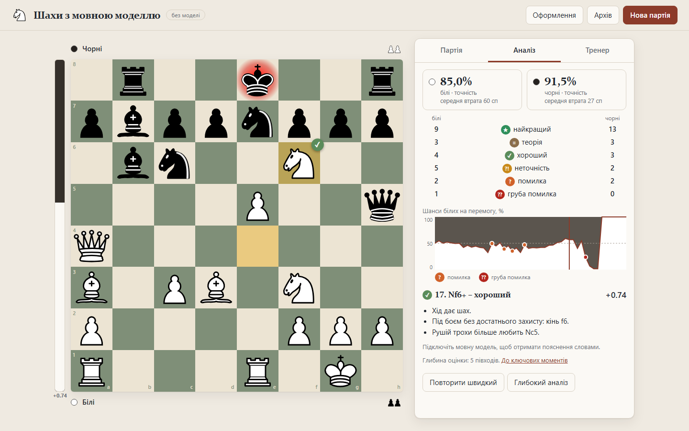

# Шахи з мовною моделлю

Курсова робота «Розроблення шахової гри з використанням великих мовних моделей».



## Можливості
- гра білими, чорними або випадковим кольором; 5 рівнів складності;
- суперник: власний рушій, мовна модель або друга людина за тим самим екраном;
- ходи мишкою (перетягування чи «клік–клік»), дотиком або текстом: `e2e4`, `Nf3`, `Кf3`, `O-O`;
- запис ходів, перегляд, скасування, підказка, архів, імпорт та експорт PGN;
- аналіз партії: точність, класи ходів, графік шансів, найкращі варіанти;
- пояснення ходів і тренер-чат від мовної моделі;
- світла й темна теми, три дошки, версія для телефона.

## Запуск
Потрібен Python 3.11 або новіший.

```powershell
pip install -r requirements.txt
```
```powershell
python run.py
```
Відкрийте <http://127.0.0.1:8000>.

### Підключення мовної моделі (необов'язково)
Скопіюйте `.env.example` у `.env`, впишіть адресу сервісу, ключ і назву моделі, перезапустіть сервер.
Підходить будь-який сервіс з OpenAI-сумісним API, зокрема локальна Ollama. Без моделі гра працює повністю,
крім LLM-суперника, пояснень словами та тренера.

## Структура
| Папка / файл | Що там |
|---|---|
| `app/game.py` | партія: ходи, скасування, результат, PGN |
| `app/engine.py` | рушій: негамакс, альфа-бета, оцінка |
| `app/analysis.py` | аналіз ходів |
| `app/llm.py` | мовна модель: суперник, пояснення, тренер |
| `app/openings.py`, `app/storage.py` | дебюти; архів партій |
| `app/main.py` | HTTP-сервер |
| `static/` | інтерфейс |
| `tests/` | автоматичні тести |
| `tools/` | турнір рівнів, вимірювання LLM, автоматичні скріншоти |
| `docs/` | план, щоденник, матеріали для роботи й захисту |
| `screenshots/` | скріншоти за версіями |

## Тести
```powershell
python -m unittest
```

## Сторонні матеріали
Зображення фігур – набір Colin M.L. Burnett, що постачається з python-chess (GPL-3.0-or-later).
