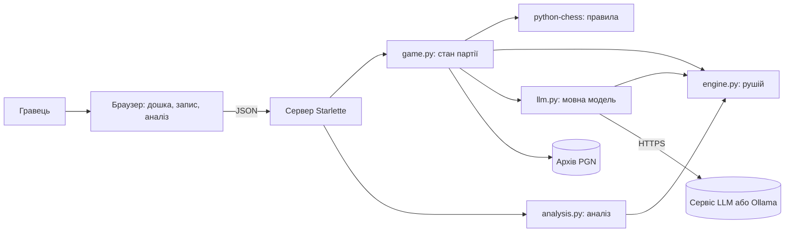
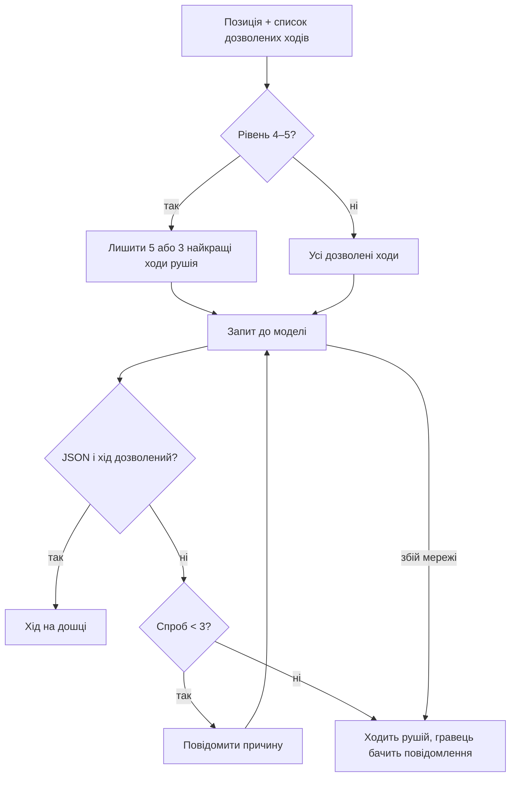

# Матеріали для курсової роботи

Це не готовий текст роботи, а заготовки за розділами: що писати, які цифри, які рисунки взяти.
Джерело деталей – `docs/NOTES.md` (щоденник).

## Вступ
- **Актуальність.** Мовні моделі вільно пояснюють природною мовою, але в шахах помиляються: пропонують
  нелегальні ходи, «забувають» позицію. Класичні рушії сильні, але дають лише числа. Поєднання усуває
  слабкі місця обох.
- **Мета.** Розробити шахову гру, у якій мовна модель є суперником і тренером, а правильність гарантує
  програмний код.
- **Об'єкт** – процес взаємодії людини з шаховою програмою. **Предмет** – методи поєднання LLM з
  алгоритмічним рушієм.
- **Задачі** – розділ 1 файлу `PLAN.md`.

## Розділ 1. Аналіз предметної області
Теми: правила й нотації (SAN, UCI, FEN, PGN); мінімакс і альфа-бета; що таке LLM, токени, «галюцинації»;
чому LLM не тримає позицію; підходи до поєднання. *Джерела треба підібрати самостійно й перевірити.*

| Критерій | Тільки рушій | Тільки LLM | Поєднання (ця робота) |
|---|---|---|---|
| Легальність ходів | завжди | не гарантована | завжди (перевірка кодом) |
| Пояснення словами | ні | так, але може вигадати | так, за фактами рушія |
| Робота без мережі | так | лише локальна модель | так, з обмеженням |

## Розділ 2. Проєктування

### Архітектура

### Хід мовної моделі

### HTTP-інтерфейс
| Метод і шлях | Дія |
|---|---|
| POST `/api/games` | нова партія (колір, суперник, рівень) |
| GET `/api/games` · POST `/api/import` | архів · імпорт PGN |
| GET `/api/games/{id}` | стан партії |
| POST `…/move` · `…/reply` | хід гравця · хід суперника |
| POST `…/undo` · `…/resign` · `…/hint` | скасувати · здатися · підказка |
| GET, POST `…/analysis` | стан · запуск аналізу |
| POST `…/explain` · `…/chat` | пояснення ходу · тренер |
| GET `…/pgn` | файл партії |

## Розділ 3. Реалізація
### Рушій
Оцінка: матеріал + таблиці «фігура–поле», плавний перехід мітельшпіль → ендшпіль, бонус за двох слонів.
Пошук: негамакс, альфа-бета, ітеративне заглиблення, таблиця транспозицій, пошук спокою (взяття),
нульовий хід, «вбивці», евристика історії, скорочення пізніх ходів, подовження під шахом.

| Рівень | Глибина | Час, с | Випадковий хід | Розкид оцінки, сп |
|---|---|---|---|---|
| 1 Новачок | 1 | 0,5 | 35 % | ±120 |
| 2 Легкий | 1 | 1 | 10 % | ±60 |
| 3 Середній | 2 | 2 | – | ±25 |
| 4 Складний | 4 | 2,5 | – | – |
| 5 Експерт | 12 (обмежує час) | 5 | – | – |

### Аналіз
W = 100 / (1 + e^(−0,00368208·cp)); L = W(до) − W(після); A = 103,1668·e^(−0,04354·L) − 3,1669.
Класи: L < 1 найкращий; < 5 хороший; < 10 неточність; < 20 помилка; ≥ 20 груба помилка.

### Мовна модель
Список із шести захистів – у `NOTES.md`, етап 6. Приклад запиту – функція `move_messages` у `app/llm.py`.

### Інтерфейс
Дошка без бібліотек на Pointer Events; сервер віддає дозволені ходи, клієнт правил не дублює.

## Розділ 4. Тестування та результати
- автоматичні тести: **72**, запуск `python -m unittest`;
- перевірка в браузері: сценарії `tools/shots_0*.mjs` виконують справжні рухи миші в Microsoft Edge;
- порівняння рівнів (турнір `python -m tools.tournament 16 5`, 64 партії, вони не зберігалися):

| Вищий рівень | Нижчий | Партій | Перемог | Нічиїх | Поразок | Очки |
|---|---|---|---|---|---|---|
| Легкий | Новачок | 16 | 16 | 0 | 0 | 100 % |
| Середній | Легкий | 16 | 16 | 0 | 0 | 100 % |
| Складний | Середній | 16 | 16 | 0 | 0 | 100 % |
| Експерт | Складний | 16 | 12 | 3 | 1 | 84,4 % |

  Кожен рівень перемагає попередній, отже шкала складності працює. Три пари завершилися 16:0, тому різницю
  Elo для них визначити не можна; для пари 5–4 оцінка +293 Elo, але 16 партій – мала вибірка.
  Сходинки між рівнями 1–4 великі: за потреби можна додати проміжні рівні.
- прискорення рушія: таблиця в `NOTES.md`, етап 5;
- **мовна модель: ще не виміряно.** Запустити з ключем `python -m tools.llm_benchmark 20` і вставити
  отриманий файл `docs/data/llm_*.json`. Без цього не пишіть у роботі висновків про якість моделі.

### Помилки, знайдені тестами та переглядом скріншотів
| Помилка | Як знайшли | Рішення |
|---|---|---|
| «0000» вважалося ходом | тест | відхилення нульового ходу |
| нічия на півхід раніше | тест | власна перевірка повторення |
| несиметрична оцінка | тест дзеркала | `int()` замість `//` |
| «сплющена» горизонталь | скріншот v0.1 | сітка з фіксованими рядками |
| підказка червоним | скріншот v0.4 | окремий стиль повідомлення |
| підпис шкали боком | скріншот v0.5 | горизонтальний підпис |
| кнопка дублювала факти | скріншот v0.6 | показується лише з моделлю |
| однакові партії в турнірі 4–5 | перегляд довжин партій | різні дебюти для кожної пари партій |
| той самий хід оцінювався по-різному | порівняння скріншотів v0.5 і 07/00 | ліміт позицій замість часу |

## Висновки (тези)
1. Легальність гри не залежить від моделі: хід завжди перевіряє код.
2. Пояснення спирається на факти рушія; вигадані ходи позначаються.
3. Гра працює без моделі та без інтернету.
4. Обмеження: швидкість Python (неглибокий пошук, довгі жертви оцінюються неточно), малий довідник
   дебютів, сервер розрахований на одного користувача локально.
5. Розвиток: Stockfish для аналізу, рушій на C++/Rust, годинник, гра мережею, порівняння кількох моделей.

## Рисунки
Повний перелік із підписами – `screenshots/README.md`.

## Про використання ШІ під час розроблення
Код, тести й ці нотатки створено за допомогою Claude Code (мовна модель Anthropic); це видно і в
історії комітів. Перевірте правила кафедри та вкажіть це в роботі. Перед захистом прочитайте код:
ви маєте вміти пояснити кожен файл.
